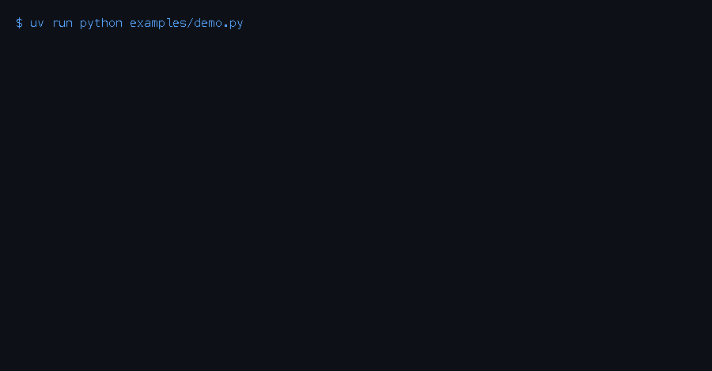
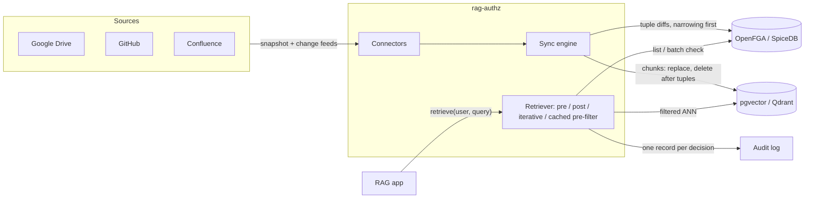

# rag-authz (working name)

Sync Google Drive, GitHub and Confluence permissions into OpenFGA or SpiceDB, and enforce them inside pgvector or Qdrant search, so a RAG app only retrieves what each user may read, and a revoke takes effect on the next query.



> **Status: v0.1, pre-release, local development only.** Every connector is tested against a fake API built from the documented response shapes, not yet against a real tenant (see [Limitations](#limitations)).

## Benchmark

Synthetic organisation: 2,000 users, 10,000 docs, skewed group membership, 500 probes (half aimed at content the user may not see), k = 10. All of it is reproducible with `make bench-matrix bench-followups`. Full tables, three seeds, engine arms and threats to validity are in [docs/benchmark/results.md](docs/benchmark/results.md). One Intel Mac, all services on localhost.

**Leaks and recall** (OpenFGA + pgvector, seed 7):

| strategy | queries that leaked | recall@10 | p95 |
|---|---:|---:|---:|
| no filter (baseline) | **100%** | 0.12 | 4 ms |
| post-filter (ANN top 40, then check) | 0 | 0.34 | 180 ms |
| iterative (growing windows, then check) | 0 | 0.92 | 3.9 s |
| pre-filter (engine lists allowed docs) | 0 | **1.00** | 90 ms |
| cached pre-filter (list cached, hits re-checked) | 0 | **1.00** | **40 ms** |

Results across combinations:

- **Zero leaking queries** for every filtered strategy across OpenFGA/SpiceDB × pgvector/Qdrant, three seeds, and a workload of broad-reach users. The leaks are scored by an independent oracle.
- **Post-filter**, the usual "permission-aware RAG" recipe, returns about a third of the answer for typical users.
- **Pre-filter's cost grows with reach.** On SpiceDB its p95 rises to 2.9 s for users who see half the corpus. The cached list removes that cost: 136–177 ms for the same users.

**Revocations** (`benchmarks/revocation_lag.py`, 20 trials per row):

| | result |
|---|---|
| Revoke one folder grant covering 10,000 docs | **1 tuple, 4–7 ms**. A flattened model rewrites 10,000 tuples: 3.5–4.8 s |
| Responses that still returned a revoked doc | **0** on OpenFGA (every mode) and on SpiceDB with `full` or `at_least_as_fresh` (ZedTokens) |
| SpiceDB with `minimize_latency` | the revoked doc came back in 11–15 of 20 trials, for up to 4.9 s |
| Sidecar HTTP hop | 3 ms p50 |

What this means for configuration ([ADR-0004](docs/adr/0004-default-strategy.md)):
- `pre_filter` is the default;
- `cached_pre_filter` is the recommended production setting;
- on SpiceDB, use `at_least_as_fresh`, never `minimize_latency`.

## Quickstart

```sh
make dev       # uv sync --frozen --all-extras
make up-full   # OpenFGA, SpiceDB, pgvector (Postgres), Qdrant: pinned by digest, localhost only
make demo      # the GIF above, against the live stack
```

`make check` runs lint, `mypy --strict` and the unit tests, including in-memory leak tests. `make integration` runs the differential tests and the leak matrix against every engine and index.

### As a library

```python
from rag_authz.authz.openfga import OpenFGABackend
from rag_authz.index.pgvector import PgVectorIndex
from rag_authz.integrations.langchain import AuthzRetriever
from rag_authz.retrieval import AuthorizedRetriever

engine = AuthorizedRetriever(OpenFGABackend("http://127.0.0.1:58080"), PgVectorIndex(dsn, dim=768))
retriever = AuthzRetriever(engine=engine, embeddings=my_embeddings).for_subject("alice@example.com")
docs = retriever.invoke("how do we rotate deploy keys?")
```

LlamaIndex: `rag_authz.integrations.llamaindex.AuthzLlamaRetriever(engine, embed_model, subject=...)`.

### As a sidecar (the enforcement boundary)

The sidecar holds the engine and vector-store credentials, so applications cannot query the index unfiltered:

```sh
uv run rag-authz hash-token chat-app        # prints a token for the app and its RAG_AUTHZ_CALLERS entry
export RAG_AUTHZ_CALLERS=chat-app:<sha256> RAG_AUTHZ_DIM=768
uv run rag-authz serve                      # POST /v1/retrieve {"subject", "vector", "k"}
```

### Syncing a source

```sh
export RAG_AUTHZ_GITHUB_ORG=acme RAG_AUTHZ_GITHUB_TOKEN=... RAG_AUTHZ_IDENTITY_MAP=identities.json
uv run rag-authz sync github                         # ACL-only: your app keeps ingesting content
uv run rag-authz sync github --embedder my.module:embed   # or let the sync engine embed it
```

`gdrive` and `confluence` work the same way (variables in `src/rag_authz/config.py`). Incremental feeds:
- `GitHubConnector.webhook_events`, with `verify_signature`;
- `GoogleDriveConnector.changes`;
- `ConfluenceConnector.changes`.

Run reconcile on a schedule as well: it covers the changes sources do not publish ([ADR-0005](docs/adr/0005-incremental-sync.md)).

## How it works



- **Permissions keep their source structure.** A folder, space or team grant is one tuple on the folder, space or team. A Drive limited-access folder is the *absence* of a parent tuple. A Confluence view restriction is intersective, as Confluence evaluates it. So revoking a folder grant is one write, however many documents sit below ([ADR-0002](docs/adr/0002-acl-normalisation-model.md)).
- **One safety invariant for every strategy.** A hit is returned only if the engine said "yes" for that document during this request. Engine errors, per-item errors and unknown documents all deny ([ADR-0003](docs/adr/0003-filter-strategies.md)).
- **Fail closed everywhere else.** The following are never searchable:
  - Drive link-only and metadata-only grants;
  - unmapped identities;
  - Confluence access classes the API cannot enumerate;
  - hierarchies deeper than the engine resolves.
- **An executable spec.** A plain-Python oracle evaluates the same tuples. OpenFGA and SpiceDB are differentially tested against it, and every leak number is scored by it.
- **Deletions reach both stores, tuples first.** A document is unretrievable before its chunks are purged.
- **Every decision is audited.** Records carry the subject, the calling app, returned and denied ids, and timings, never content.

Architecture: [context](docs/architecture/c4-context.md) and [container](docs/architecture/c4-container.md) diagrams. Decisions:
- [ADR-0001 stack and trust boundary](docs/adr/0001-stack.md)
- [ADR-0002 ACL model](docs/adr/0002-acl-normalisation-model.md)
- [ADR-0003 strategies](docs/adr/0003-filter-strategies.md)
- [ADR-0004 default strategy](docs/adr/0004-default-strategy.md)
- [ADR-0005 incremental sync](docs/adr/0005-incremental-sync.md)

## Alternatives (as of 2026-09-27; re-verify before relying on this)

| Project | What it does | Difference |
|---|---|---|
| Onyx (MIT core) | Enterprise search app | Permission sync is Enterprise Edition only |
| PipesHub (Apache-2.0) | Enterprise search app with source-ACL sync and Qdrant pre-filtering | A full app with its own graph store. We found no handling of Drive link-only sharing, limited-access folders or nested Google groups, and no published leak or lag numbers |
| Airweave (MIT) | Connector and context layer | Archived 2026-08-29 |
| `langchain-spicedb`, Auth0 `FGARetriever` | Retriever-side filtering over existing tuples | No source connectors |
| Paragon Permissions API, DataRobot ACL Hydration, Glean, Azure AI Search (SharePoint ACLs, preview) | Commercial or closed | Not open source; Azure needs an explicit refresh for inherited permission changes |

Sources and caveats: [docs/research](docs/research/).

## Limitations

- **Connectors are untested against real tenants.** They are built from Atlassian's, Google's and GitHub's documented response shapes and tested against fakes of those shapes. The first real-tenant runs are the top roadmap item.
- **The sidecar trusts its caller to name the end user.** Callers authenticate with tokens, but end-user OIDC verification is on the roadmap.
- **Some changes only converge on reconcile,** because the sources publish no feed for them:
  - GitHub base-permission changes;
  - Google group membership;
  - Confluence restriction changes, deletions and group changes.

  Their lag is your reconcile interval ([ADR-0005](docs/adr/0005-incremental-sync.md)).
- **Deep hierarchies lose recall.** SpiceDB's LookupResources fails past 21 nested containers, and OpenFGA's Check denies past 24. Connectors report `max_depth` ([research note](docs/research/2026-10-28-resolution-depth.md)).
- **Scope:**
  - internal GitHub repos are visible to org members only, not enterprise-wide;
  - Drive syncs shared drives, not My Drive;
  - Confluence access classes other than anonymous need an explicit stand-in group.
- **The benchmark workload is synthetic.** Its knobs are explicit and swept, but no real tenant's ACL statistics calibrate it ([threats to validity](docs/benchmark/plan.md#threats-to-validity)).

## Roadmap and contributing

See [docs/roadmap.md](docs/roadmap.md).
- Record design changes as a new ADR in `docs/adr/`.
- A schema change must update `schema.py`, the oracle, the golden files and the differential tests together.
- A connector change needs a fixture test that pins the new rule to the oracle's verdict.
- Security reports: [SECURITY.md](SECURITY.md).

## Licence

Apache-2.0.
