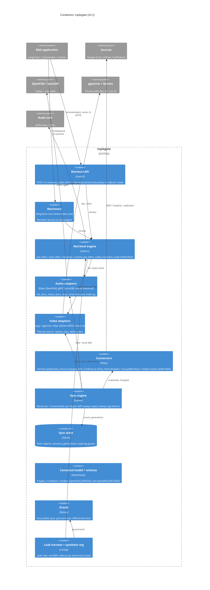
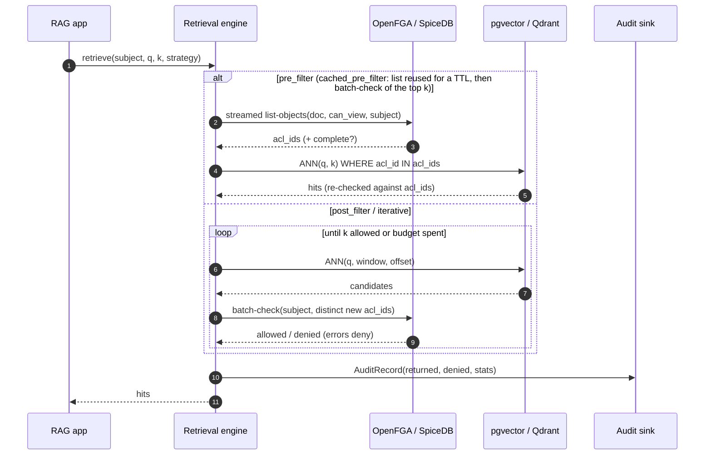
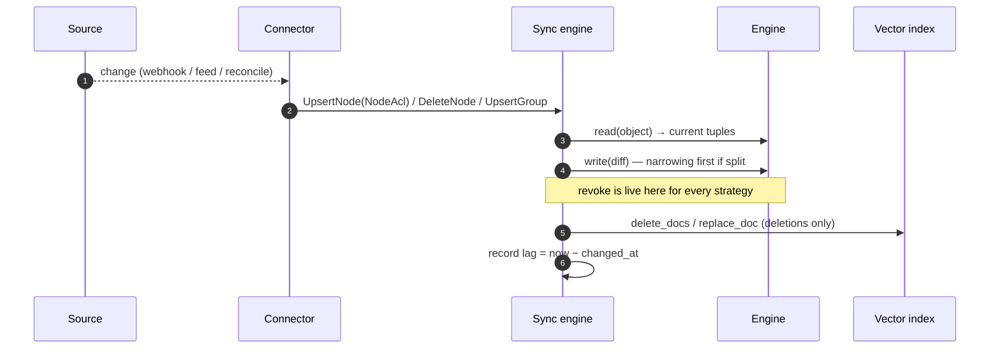

# C4 level 2: containers

v0.1 is one Python package (`tuplegate`) that runs in two shapes: imported into an application (library mode) or behind a FastAPI process (sidecar mode, `tuplegate serve`). The boxes inside the boundary are modules, not services. Each is drawn separately because it has its own contract and ADR.

## Request path: authorised retrieval

## Sync path: a revoke reaches the index and the engine

Order matters on delete: tuples go first, so the document is unretrievable before its chunks are purged. A failed purge leaves orphan chunks that no strategy can return, because no tuple grants them. `replace_doc` then removes them before any re-ingest under the same id, so a later, wider ACL cannot expose them.
