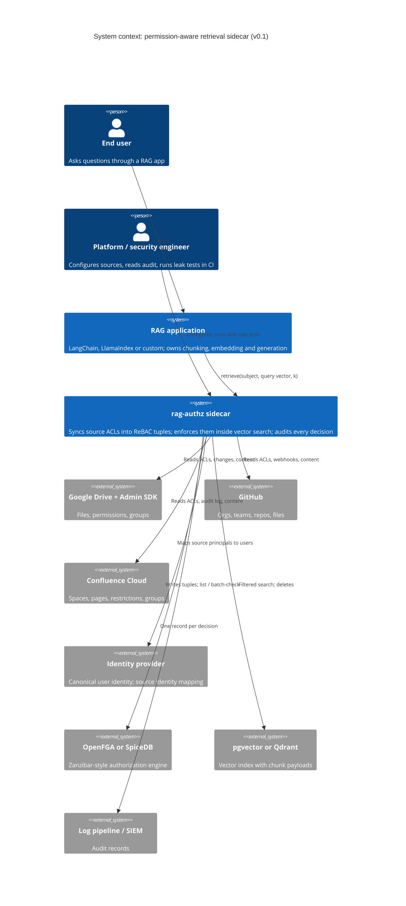

# C4 level 1: system context

The sidecar sits between a RAG application and the vector store. It never sees a model prompt or generates an answer. It decides which chunks a user may retrieve and keeps that decision in step with the source systems.

## Boundaries that matter

- **Trust boundary (ADR-0001).** In sidecar mode, only the sidecar holds vector-store and engine credentials. The application cannot query the index unfiltered. In library mode, the application is inside the boundary.
- **Ownership of content.** The application owns chunking and embedding. The sidecar owns ACLs and deletions, and the contract between them is that every chunk carries `doc_id`. An optional ingest helper can drive the application's chunker and embedder from connector events, which keeps the demo to one command without taking an opinion on either.
- **Sources of lag.** Revocation lag has two parts: the source's own feed lag (for example, hours for Google group changes, and no webhook for GitHub base permission) and the sidecar's lag (one tuple write, ADR-0002). The benchmark reports them separately.
